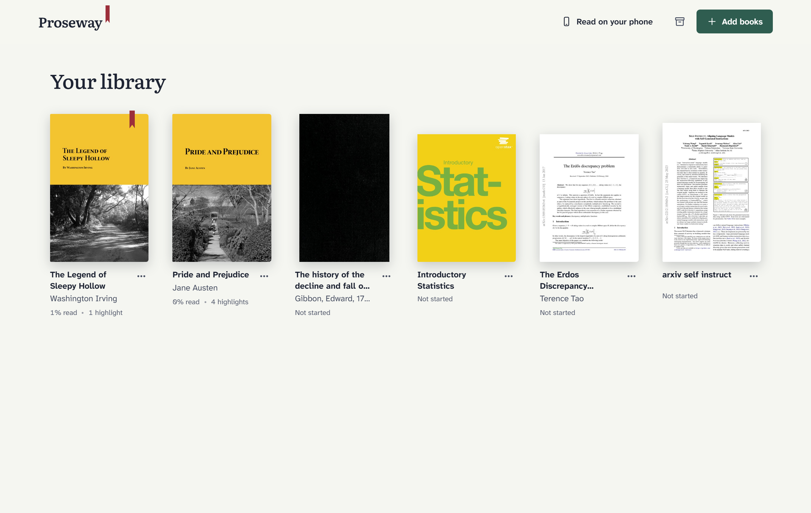
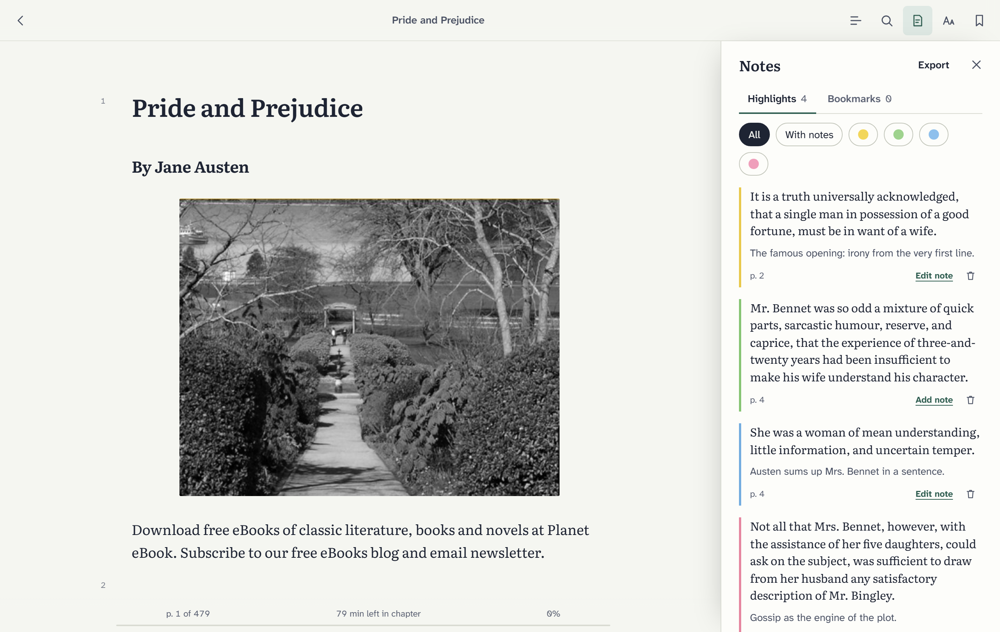
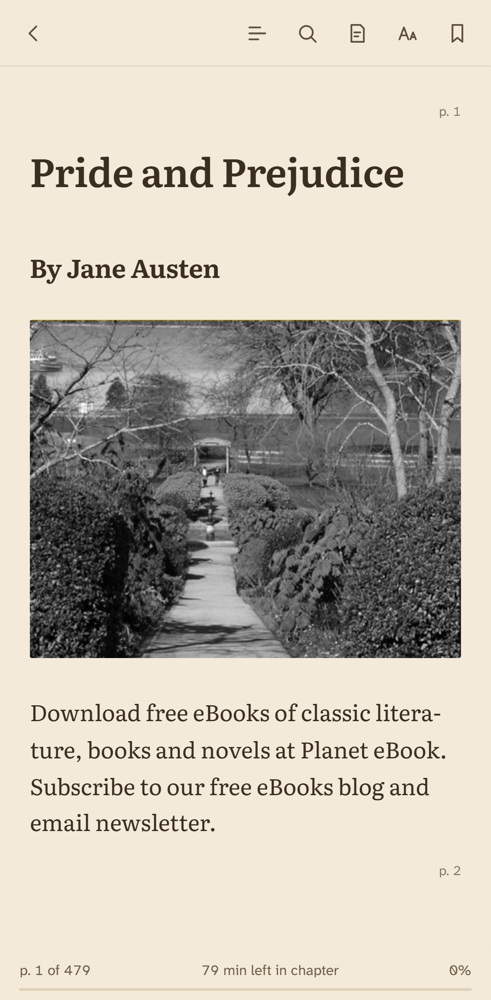

# Proseway

**Turn a book PDF you own into a calm, reflowable edition you can actually read on your phone.**

Proseway runs on your own computer. It reads a PDF, strips out the things that only make sense on a printed page (running headers, page numbers, words split across lines), and gives you a clean edition in a reader you can resize, re-theme, highlight and annotate. Every paragraph remembers which page of the original it came from, so you can still cite "p. 47".

No account, no cloud, no telemetry. After you install it, it works offline.



## Why

Printed books use small type, and that's fine on paper. A PDF of that book on a phone is a page you have to pinch, zoom and pan around, and highlighting it is clumsy at best. Proseway turns the page back into text, so the text can fit your screen.

| Reading with notes on a laptop | On a phone |
|---|---|
|  |  |

## What you can do

- **Import** one PDF or many by dropping them on the window. Conversion runs in the background with page-by-page progress. You can stop it and resume later, and a 1,000-page textbook converts in about four minutes on an ordinary laptop.
- **Read** in four themes (Paper, Sepia, Dusk, Night), five typefaces (including OpenDyslexic and Atkinson Hyperlegible), with your choice of text size, line spacing and line length.
- **Find your way** with the table of contents, full-text search, the page number of the original PDF in the margin, and minutes left in the chapter. After any jump, a "Back to p. 47" button takes you back.
- **Mark it up**:
  - highlights in five colours;
  - notes on any highlight;
  - bookmarks;
  - footnotes that open in place;
  - copy a passage with its page reference.
- **Keep your notes**:
  - Highlights are saved the moment you make them.
  - They survive re-converting the book with a newer version of Proseway.
  - They're kept even if you remove the book, and come back when you import it again.
  - Export a book's notes as Markdown, or all notes as a JSON backup you can restore.
- **Read on your phone** over your home Wi-Fi after a one-time pairing (see below), or download any book as an EPUB file for any e-reader app.

## Install

You need **Python 3.10 or newer**. The easiest way to install Python tools is [uv](https://docs.astral.sh/uv/).

From a release (no other tools needed):

```sh
uv tool install https://github.com/georgegideonsale/proseway/releases/download/v0.1.0/proseway-0.1.0-py3-none-any.whl
```

From source (also needs [Node.js 20+](https://nodejs.org/) to build the reader):

```sh
uv tool install git+https://github.com/georgegideonsale/proseway
```

Then run it:

```sh
proseway
```

Your browser opens at `http://127.0.0.1:8765`. Your library lives in your user data folder (`%LOCALAPPDATA%\Proseway` on Windows, `~/Library/Application Support/Proseway` on macOS, `~/.local/share/proseway` on Linux). `proseway --help` lists the options, including `--data-dir` and `--port`.

`pipx install …` works the same way as `uv tool install …` if you prefer pipx.

### Scanned books (optional OCR)

Some PDFs are only pictures of pages. Proseway keeps those pages as images. To turn them into text, install the optional OCR add-on (about 60 MB, CPU only):

```sh
uv tool install --with rapidocr-onnxruntime <same source as above>
```

Then convert the book again from its menu in the library. OCR takes a few seconds per page.

## Reading on your phone

Proseway only listens on your own computer until you say otherwise.

1. In the library, choose **Read on your phone** and turn sharing on. Leave **Secure connection** ticked.
2. Make sure your phone is on the same Wi-Fi.
3. **The first time on each phone,** choose **Set up this phone** and scan that code. It opens a page where you download Proseway's certificate, with the steps to trust it:
   - **iPhone/iPad:** in Safari, download it, install the profile in Settings, then turn on full trust under *Settings → General → About → Certificate Trust Settings*.
   - **Android:** download it, then install it under *Settings → Security → Encryption & credentials → Install a certificate → CA certificate*. Menu names vary by phone.

   Before you trust it, check that the fingerprint your phone shows matches the one on your computer.
4. Scan the pairing QR code with your phone's camera, or open the address shown and type the six-digit code.

With the secure connection, your phone can add Proseway to its home screen and keep the chapters you've opened for reading offline. The certificate Proseway makes can only vouch for home-network addresses, never for websites. You can remove it from your phone at any time.

What sharing does and doesn't allow:
- Sharing switches itself off after the time you choose (2 hours by default) and is always off when Proseway starts.
- A paired phone can read, search, highlight and take notes. It can't import, delete or change settings.
- You can unpair a phone at any time.
- If you untick **Secure connection**, the phone uses plain HTTP. There's no certificate step, but also no offline reading, and someone on the same network could see what you read. Only do that on a network you trust (see [SECURITY.md](SECURITY.md)).

Want to read on the train, away from your computer? Use **Download as EPUB** from a book's menu and open the file in any EPUB reader on your phone.

## How faithful is the text?

The conversion keeps the book's own words in the book's own order. It removes:
- running headers and footers;
- printed page numbers;
- the hyphens that only exist because a word was split across two lines.

It keeps:
- chapters, headings and paragraphs;
- lists;
- footnotes, linked to where they're cited;
- tables;
- figures with their captions;
- equations, as an image of the original with the text kept for search;
- code.

We measure this on public-domain and openly licensed books (`scripts/benchmark.py`). On novels, the converted text matches the independent Project Gutenberg edition at about 97% (word-sequence similarity). The full table, including the harder cases, is in [PROGRESS.md](PROGRESS.md). The harder cases are a two-column paper, a maths paper, an 1850 scan with footnotes, and an image-only scan.

Things it doesn't do well yet:
- complex multi-column layouts with floating figures;
- text drawn inside figures;
- tables without ruling lines;
- noisy OCR in old scans.

## Your books, your rights

Proseway converts files you already have, for your own reading. It does **not** remove DRM, and it doesn't download books. If a PDF is password-protected, or its author turned off text extraction, Proseway says so and leaves it alone.

## Privacy

Proseway makes no network requests of its own: no analytics, no update checks, no fonts or scripts from the web. Everything it stores lives in its data folder on your computer. You can check this yourself. The server code is in `src/proseway/server.py`, and the web app's Content Security Policy only allows connections to the computer it's running on.

## Contributing

Bug reports with a sample PDF (one you're allowed to share) are the most useful thing you can send. See [CONTRIBUTING.md](CONTRIBUTING.md) for how to set up a development copy and run the tests, and [ROADMAP.md](ROADMAP.md) for what's planned.

## License

Apache-2.0. See [LICENSE](LICENSE). Third-party licences are listed in [docs/research/licenses.md](docs/research/licenses.md).
